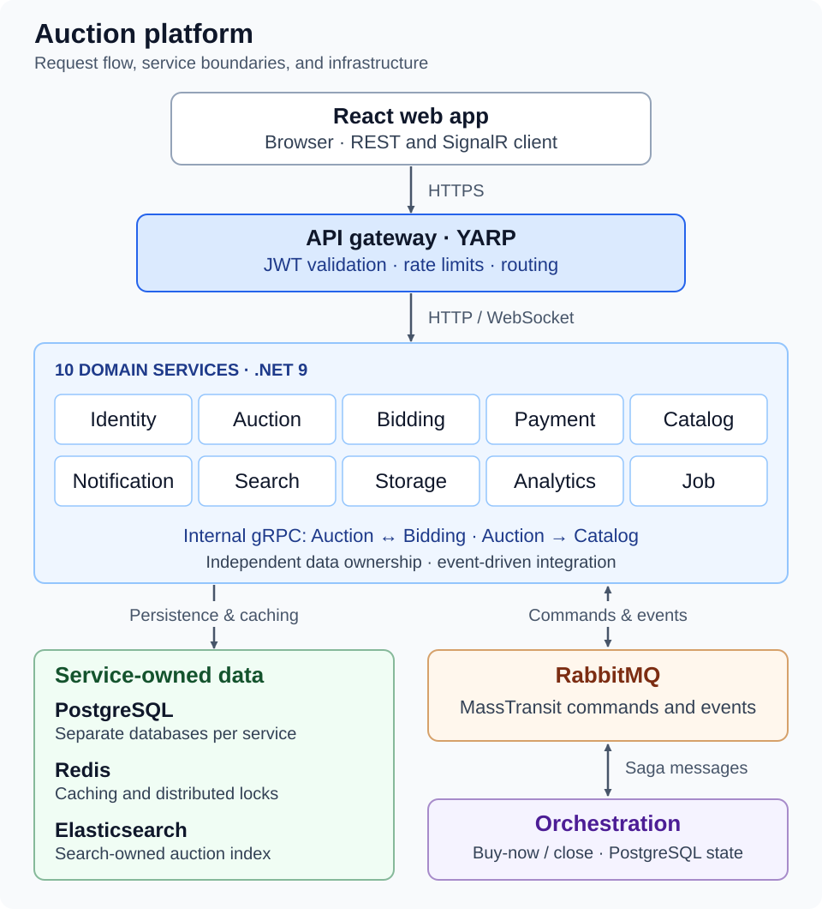
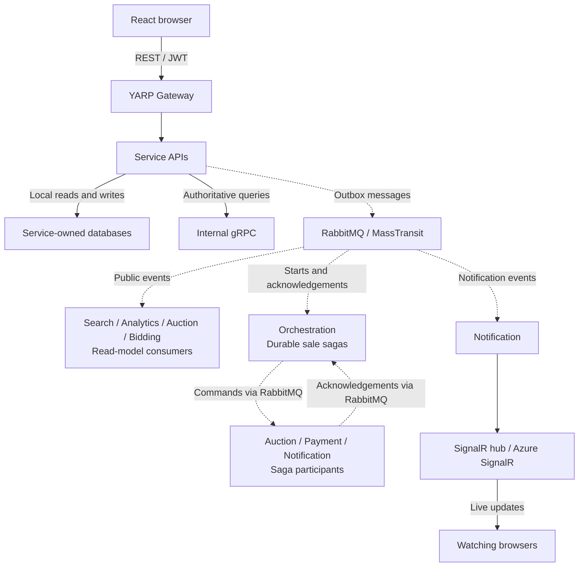
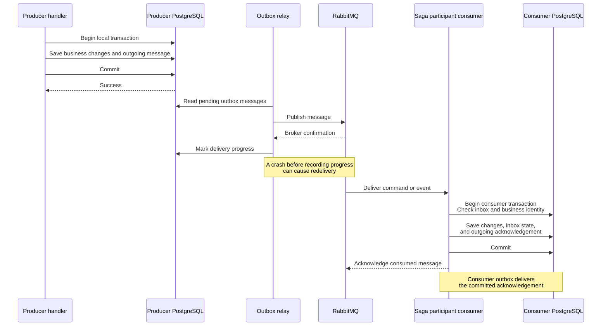
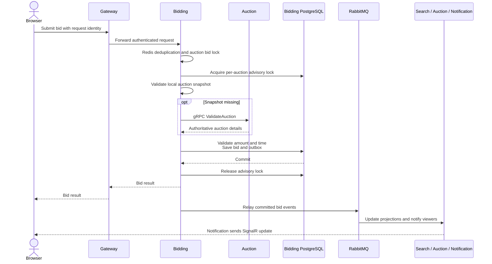
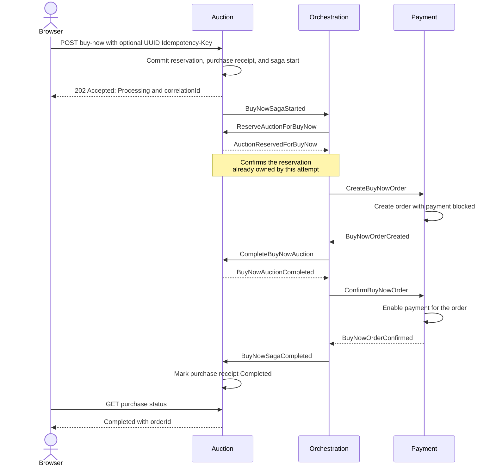
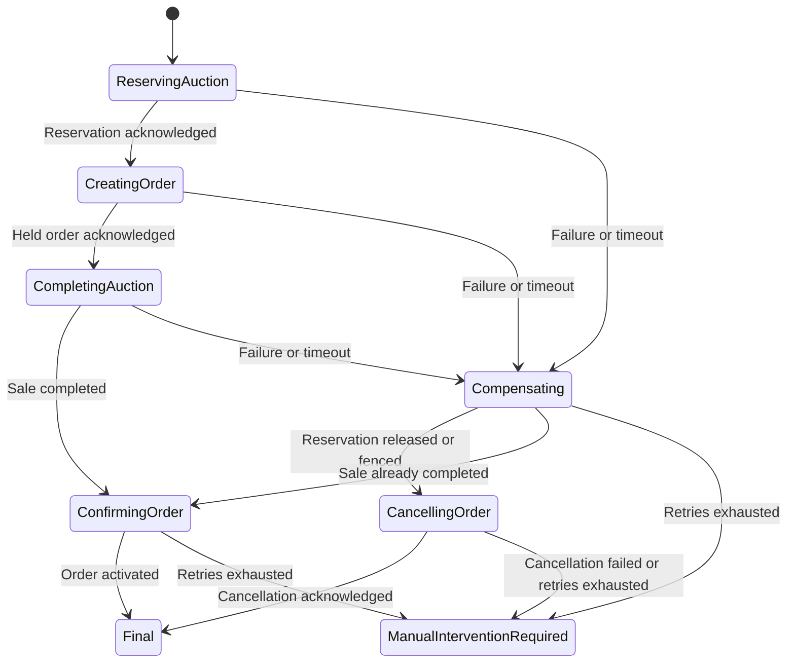
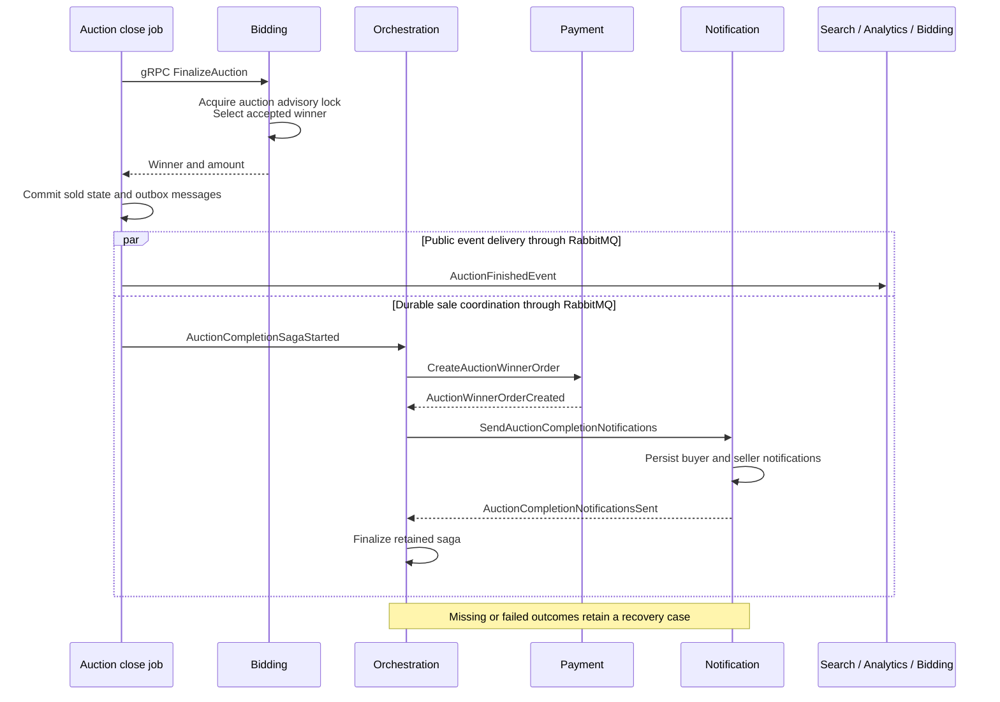
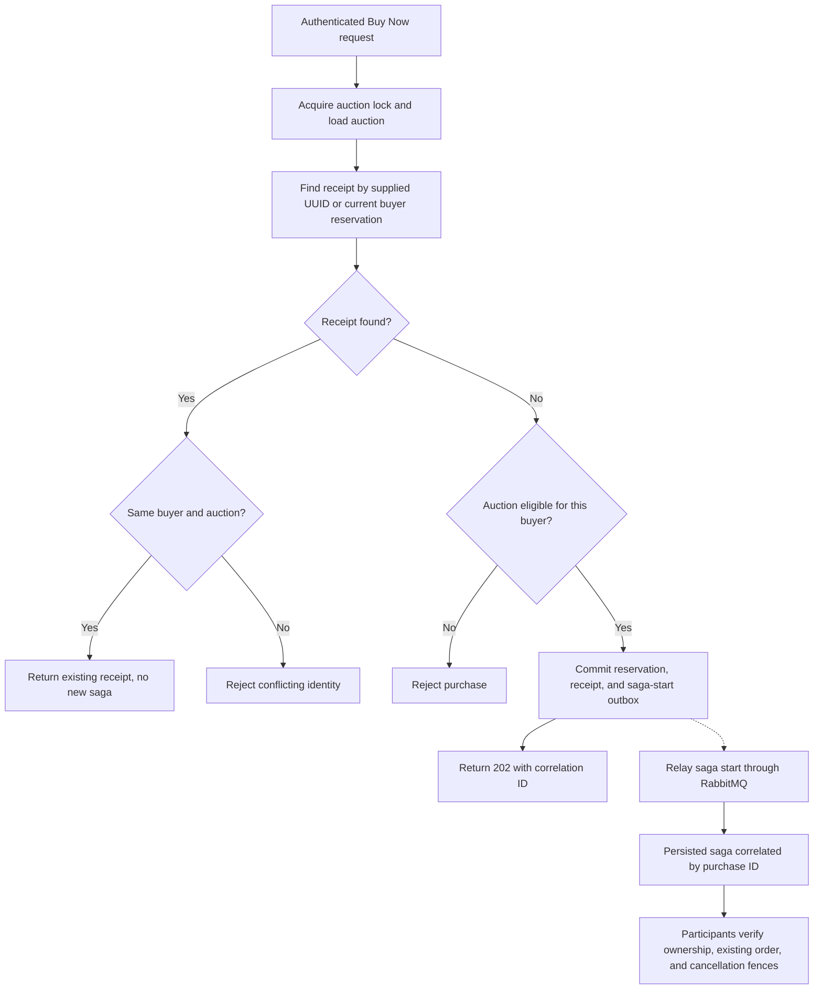
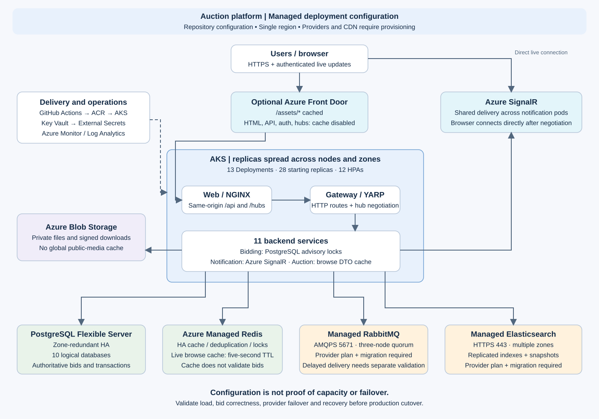

# Auction Platform — Microservices

A portfolio-focused, event-driven auction platform built with **.NET 9 microservices** and a **React 19 frontend**.
The system supports real-time bidding, authoritative auction closing, buy-now flows, integrated payments, multi-channel notifications, full-text search, file storage, analytics, and scheduled jobs — all behind a unified API gateway.

[](https://github.com/blanho/auction-platform-microservices/actions/workflows/ci.yml)
[](https://github.com/blanho/auction-platform-microservices/actions/workflows/cd.yml)
[](https://github.com/blanho/auction-platform-microservices/actions/workflows/sonar.yml)

## Contents

- [Architecture Overview](#architecture-overview)
- [System Architecture Diagram](#system-architecture-diagram)
- [Service Communication](#service-communication)
- [Event Delivery and Transactional Outbox](#event-delivery-and-transactional-outbox)
- [Service Map](#service-map)
- [Tech Stack](#tech-stack)
- [Key Workflows](#key-workflows)
  - [Bid Placement](#bid-placement)
  - [Buy Now Saga](#buy-now-saga)
  - [Compensation and Recovery](#compensation-and-recovery)
  - [Auction Completion Saga](#auction-completion-saga)
- [Idempotency and Replay Protection](#idempotency-and-replay-protection)
- [Getting Started](#getting-started)
- [Cloud and Deployment](#cloud-and-deployment)
- [Testing](#testing)
- [Documentation](#documentation)

## Architecture Overview

The platform follows a **domain-driven microservices** architecture with strict bounded contexts. Each service owns its data, communicates asynchronously through RabbitMQ (via MassTransit), and exposes REST endpoints through a centralized YARP API gateway. Immediate authoritative queries use internal gRPC. The React frontend connects via REST and receives real-time updates through SignalR WebSockets.

**Core architectural patterns:**

| Pattern | Implementation |
|---|---|
| Domain-Driven Design | Bounded contexts per service, aggregates, value objects, domain events |
| CQRS | Separate command/query models via MediatR |
| Domain Events | Aggregate events published through transactional outboxes; current state remains in service databases |
| Event-driven workflows | Durable MassTransit sagas for Buy Now and auction completion; idempotent participants and transactional outboxes |
| Transactional Outbox | Atomic state/message persistence with retryable, at-least-once delivery |
| API Gateway | YARP reverse proxy with JWT validation and rate limiting |

---

## System Architecture Diagram

The overview groups the services and shows the main request, data, and messaging paths.
Click the diagram to open the full-size SVG.

[](docs/diagrams/auction-system-overview.svg)

For service responsibilities, see the [Service Map](#service-map). For detailed
interactions, external integrations, and observability, see the
[Architecture Guide](docs/architecture.md). The [cloud deployment diagrams](docs/diagrams/README.md)
show Azure and Kubernetes details, with an
[editable draw.io file](docs/diagrams/auction-azure-architecture.drawio).

## Service Communication

The browser uses REST through YARP. Services publish events and saga messages
through MassTransit/RabbitMQ; internal gRPC handles queries that need an immediate
authoritative answer. Each service owns its persistence and updates its own data.



Solid arrows show request or live-delivery paths; dotted arrows show asynchronous
messaging. Saga participant arrows also travel through RabbitMQ. Each consumer
writes only its own persistence. The main internal gRPC relationships are:

| Caller | Target | Purpose |
|---|---|---|
| Bidding | Auction | Validate auction eligibility when the local snapshot is missing |
| Auction | Bidding | Select the authoritative winner at auction close |
| Auction | Catalog | Resolve catalog data |

The gateway also serves Identity, Storage, Job, and other service APIs. For live
updates, the browser negotiates through the gateway; production clients then
connect directly to Azure SignalR. See the
[Architecture Guide](docs/architecture.md#communication-patterns) for integrations.

## Event Delivery and Transactional Outbox

Service state and outgoing messages commit together. A relay delivers committed
messages to RabbitMQ. Delivery is **at least once**: a retry can deliver the same
message again, so consumers also need replay protection.



The consumer transaction above applies to endpoints configured with the EF
consumer outbox, including the sale saga participants. Other consumers use their
own deduplication or projection rules. Public events update Search, Analytics,
and other read models asynchronously, so those views can lag committed state.
Current state lives in service databases; this is an event-driven architecture,
not an event store used to rebuild every aggregate.

## Service Map

| Service | Port | gRPC | Database | Responsibilities |
|---|---|---|---|---|
| **Identity** | 5001 | — | `identity_db` | JWT issuance, OAuth (Google / Facebook), user management |
| **Auction** | 5002 | 5011 | `auction_db` | Auction lifecycle, bookmarks, reviews, media, authoritative close scheduling |
| **Bidding** | 5003 | 5012 | `bid_db` | Bid placement, auto-bids, bid history, authoritative winner selection |
| **Payment** | 5004 | — | `payment_db` | Stripe integration, wallets, order processing, refunds |
| **Notification** | 5005 | — | `notification_db` | Email (SendGrid), SMS (Twilio), Push (Firebase), SignalR hub |
| **Job** | 5006 | — | `job_db` | Tracked bulk operations, item dispatch, progress, and retries |
| **Analytics** | 5007 | — | `analytics_db` | Event ingestion, reporting, dashboards |
| **Catalog** | 5013 | 8081 internal | `catalog_db` | Categories, brands, catalog queries |
| **Search** | 5008 | — | Elasticsearch | Full-text auction search, filtering, facets |
| **Storage** | 5009 | — | `storage_db` | File upload, validation, Azure Blob / local storage |
| **Gateway** | 6001 | — | — | YARP reverse proxy, JWT validation, rate limiting |
| **Orchestration Service** | 5012 | — | PostgreSQL | Durable sale workflows, deadlines, and Admin recovery API. [Workflow and recovery notes](src/Orchestration/README.md) |

All 14 aggregate repositories across Auction, Bidding, Catalog, Job, Payment,
Notification, and Storage reuse the shared EF Core repository. Service-specific
queries, transactions, and deletion policies remain explicit. See the
[reuse guide and service audit](docs/common-repositories.md).

---

## Tech Stack

### Backend

| Category | Technology |
|---|---|
| Runtime | .NET 9, C# |
| Architecture | Clean Architecture (Domain / Application / Infrastructure / API) |
| API | ASP.NET Core Minimal API + Carter |
| CQRS / Mediator | MediatR |
| ORM | Entity Framework Core 9 |
| Messaging | MassTransit + RabbitMQ |
| Transactional Outbox | MassTransit Outbox (EF Core) |
| Workflow coordination | MassTransit state machines with PostgreSQL persistence and durable deadlines |
| gRPC | Grpc.AspNetCore / Grpc.Net.Client |
| API Gateway | YARP (Yet Another Reverse Proxy) |
| Auth | Custom JWT (HS256 / RS256), OAuth2 (Google, Facebook) |
| Caching | Redis (StackExchange.Redis) |
| Concurrency control | Redis distributed locks + PostgreSQL advisory locks for bid/finalization serialization |
| Search | Elasticsearch 8 (Elastic.Clients.Elasticsearch) |
| Logging | Serilog → Seq / Elasticsearch |
| Tracing | OpenTelemetry (OTLP-ready) |
| Validation | FluentValidation |
| Resilience | Polly (circuit breaker, retry, timeout, bulkhead) |
| Scheduling | Quartz / Hangfire (service-local background jobs) |
| Payment | Stripe .NET SDK |
| Email / SMS / Push | SendGrid, Twilio, Firebase Admin SDK |
| File Storage | Azure Blob Storage / Local |
| Testing | xUnit, NSubstitute, FluentAssertions |

### Frontend

| Category | Technology |
|---|---|
| Framework | React 19 |
| Language | TypeScript 5.9 |
| Build Tool | Vite 7 |
| UI Library | MUI (Material UI) v7 |
| Animations | Framer Motion 12 |
| Styling | Tailwind CSS 4 |
| State / Data Fetching | TanStack Query v5 |
| Routing | React Router v7 |
| Forms | React Hook Form + Zod |
| Real-time | @microsoft/signalr v10 |
| Charts | Recharts 3 |
| i18n | i18next + react-i18next |
| HTTP Client | Axios |
| Linting / Formatting | ESLint 9, Prettier 3, Husky + lint-staged |

## Key Workflows

### Bid Placement

The gateway forwards an authenticated bid to Bidding. Bidding normally validates
against its event-fed auction snapshot, using Auction gRPC when that snapshot is
missing. Bid placement and winner selection share a PostgreSQL advisory lock
derived from the auction ID.



Winner finalization acquires the same database lock before reading accepted bids.
The close job also uses a distributed job lock. These boundaries coordinate
concurrent requests; the [idempotency rules](#idempotency-and-replay-protection)
handle retries of the same work.

### Buy Now Saga

The HTTP request reserves the auction and saves a purchase receipt with the saga
start in one transaction. It returns **202 Accepted** while the durable workflow
continues. Inter-service arrows below are messages routed through RabbitMQ and
transactional outboxes; browser arrows are HTTP through the gateway.



Confirmation enables payment; it does not charge the buyer. The browser polls
`GET /api/v1/auctions/{auctionId}/purchase` and navigates to the order after the
receipt reaches `Completed`.

### Compensation and Recovery

Buy Now compensation releases or fences the reservation **before** cancelling the
order. If auction completion already won the race, the saga confirms the order.



PostgreSQL persists saga state, deadlines, and recovery cases. A deadline worker
queues overdue timeout messages; generation tokens reject stale timeouts. Bounded
retries leave unresolved work in `ManualInterventionRequired`, surfaced as
`NeedsReview` on the purchase receipt. Admin recovery retries the recorded step
with the same correlation ID, returning to compensation, cancellation, or
confirmation as appropriate. Late acknowledgements can also resolve retained work. Final saga rows remain as replay tombstones.

### Auction Completion Saga

For a sold ordinary auction, the close handler commits the final auction state,
the public completion event, and the saga start together. The sold auction stays
closed while the saga recovers order creation or notification failures.



`OrderCreationManaged` makes legacy Payment event consumers skip direct order
creation for saga-managed sales. Notification acknowledgement confirms persisted
in-app notifications; external email/SMS delivery and offline browser delivery
have separate outcomes. Notification failure preserves the sale and order.

See the [Architecture Guide](docs/architecture.md) for communication patterns and
consistency boundaries, and [Orchestration](src/Orchestration/README.md) for state
transitions, compensation, and recovery.

## Idempotency and Replay Protection

A retry can arrive through HTTP, broker redelivery, or operator recovery. Buy Now
uses a durable purchase identity so a repeated request returns the same receipt:



| Boundary | Replay protection | Scope |
|---|---|---|
| Buy Now HTTP | Persisted purchase receipt keyed by correlation ID; buyer and auction ownership checked | Optional UUID `Idempotency-Key` reuses the attempt. The current reservation owner can also recover its receipt without the header. |
| Bid HTTP | Redis key includes auction, bidder, and request key | Five-second deduplication window; duplicates return an error, and failed attempts clear the marker. This is bounded duplicate suppression. |
| Saga message delivery | EF inbox/outbox and persisted saga state | Message IDs cover transport redelivery; correlation and business identity checks cover repeated commands. Final rows prevent restarting a completed saga. |
| Buy Now participants | Reservation ownership, order identity, cancellation fences, and serialized create/cancel operations | An old release cannot release a newer reservation; a delayed create cannot revive a cancelled attempt. |
| Completion notifications | Stable reference per order and recipient, checked under a database lock | Replayed commands reuse persisted in-app notifications. |

At-least-once delivery does not imply exactly-once external side effects. Preserve
business identities and cancellation fences when replaying delayed or failed
messages. See the [workflow recovery guide](src/Orchestration/README.md#storage-deadlines-and-recovery)
before retrying unresolved purchases.

## Getting Started

### Prerequisites

| Tool | Minimum Version |
|---|---|
| [.NET SDK](https://dotnet.microsoft.com/download) | 9.0 |
| [Node.js](https://nodejs.org) | 20 LTS |
| [Docker Desktop](https://www.docker.com/products/docker-desktop) | 24+ |
| [Docker Compose](https://docs.docker.com/compose/) | v2 |

### Local Development (Docker Compose)

```bash
# 1. Clone
git clone https://github.com/blanho/auction-platform-microservices.git
cd auction-platform-microservices

# 2. Configure environment
cp .env.example .env          # Fill in required values

# 3. Start everything
docker compose -f deploy/docker/docker-compose.yml up -d

# 4. Verify health
docker compose -f deploy/docker/docker-compose.yml ps

# 5. Start the frontend dev server
cd web && npm install && npm run dev
```

The full Compose stack serves the frontend at http://localhost:3000; Vite serves
it at http://localhost:5173. The gateway is at http://localhost:6001.
See [Getting Started](docs/getting-started.md) for environment configuration,
individual services, debugging, and troubleshooting.

## Cloud and Deployment

Azure production uses Bicep, AKS, ACR, Key Vault, PostgreSQL Flexible Server,
Azure Managed Redis, and Blob Storage. The default overlay runs RabbitMQ and
Elasticsearch in AKS. Both production profiles enable Azure SignalR; the optional
managed-provider overlay replaces the in-cluster broker and search with external
providers over TLS.

### Azure Managed-Provider Architecture

[](docs/diagrams/auction-managed-ha.svg)

The diagram shows the optional `production-managed` profile. GitHub Actions builds
immutable images in ACR and deploys them to AKS through OIDC. Key Vault supplies
application secrets through External Secrets; migration Jobs complete before
application rollouts. Notification connects to Azure SignalR, and the browser
connects directly after hub negotiation through the gateway.

| Area | Default `production` | Optional `production-managed` |
|---|---|---|
| Compute | AKS deployments, autoscaling, disruption budgets, zone/host spreading | Same application deployment controls |
| PostgreSQL / cache / files | Azure PostgreSQL with zone-redundant HA, Azure Managed Redis, Blob Storage | Same Azure services |
| RabbitMQ | Single in-cluster pod | External provider, AMQPS, quorum queues |
| Elasticsearch | Single in-cluster pod | External provider over HTTPS; new indexes request one replica |
| Live updates | Azure SignalR | Azure SignalR |
| Frontend edge | Ingress delivery; optional Front Door template caches hashed assets | Same optional CDN configuration |

This is a single-region repository configuration. Provider subscriptions,
capacity, failover, and end-to-end availability still require provisioning and
staging validation. The [Azure baseline diagram](docs/diagrams/auction-azure-deployment.svg)
and [Kubernetes detail diagram](docs/diagrams/auction-kubernetes-details.svg)
preserve the earlier 24 October baseline; the managed-provider view above includes
the later scale-out configuration.

- [Deployment guide](docs/deployment.md): Docker, Kubernetes, CI/CD, secrets, monitoring, and rollback.
- [Azure deployment guide](deploy/azure/README.md): provisioning, GitHub configuration, DNS, and production rollout.
- [Architecture diagrams](docs/diagrams/README.md): Azure deployment, runtime flows, Kubernetes details, and the editable draw.io file.
- [Production readiness](docs/production-readiness.md): managed-provider migration, rollout checks, and remaining limits.

## Testing

Follow the [testing guide](docs/testing.md) to build and run all backend projects
with disposable PostgreSQL, RabbitMQ, and Elasticsearch, and to run frontend and
browser checks. The backend runner rejects failed, missing, or unexpectedly
skipped results. Use the [load-testing guide](tests/load/README.md) for staging
capacity and failure drills.

Backend builds run the pinned Sonar C# analyzer with warnings treated as errors.
Frontend validation uses ESLint and TypeScript. See [Code Quality](docs/code-quality.md)
for commands, maintenance boundaries, and localization requirements.

## Documentation

| Document | Description |
|---|---|
| [Architecture Guide](docs/architecture.md) | System design, bounded contexts, data flow, design decisions |
| [Cloud Architecture Diagrams](docs/diagrams/README.md) | Editable Azure deployment, runtime flow, and Kubernetes detail diagrams with SVG previews |
| [Getting Started Guide](docs/getting-started.md) | Step-by-step onboarding for new developers |
| [API Reference](docs/api-reference.md) | Gateway routes, authentication, request/response schemas |
| [Background Jobs](docs/background-jobs.md) | Supported job operations, payload examples, retries, and staged roadmap |
| [Paging Guide and Consistency](docs/paging-consistency.md) | Shared paging rules, typed immutable sort maps across services, compatibility differences, and verification |
| [Code Quality](docs/code-quality.md) | Local Sonar analysis, verification commands, security configuration, and reviewed exceptions |
| [Common Repositories](docs/common-repositories.md) | Research, shared EF Core CRUD and queries, audit policies, transaction boundaries, and adoption |
| [Deployment Guide](docs/deployment.md) | Docker, Kubernetes, CI/CD pipeline details |
| [Azure Deployment Guide](deploy/azure/README.md) | Provision and deploy the Azure AKS environment |
| [Testing](docs/testing.md) | Backend test runner, disposable providers, frontend checks, and browser journeys |
| [Orchestration](src/Orchestration/README.md) | Durable sale workflows, compensation, deployment, and operator recovery |
| [Production Readiness](docs/production-readiness.md) | Managed providers, rollout, capacity validation, and remaining HA limits |
| [Load Testing](tests/load/README.md) | Staging capacity tests and failure drills |

## License

This project is for educational and portfolio purposes.
