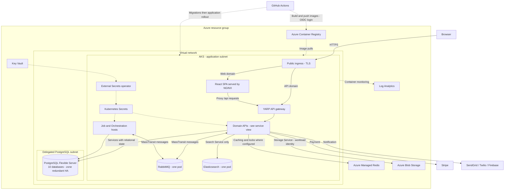
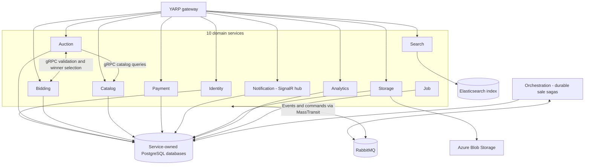

# Cloud deployment architecture

**Update, 25 October:** [Managed HA configuration and rollout](production-readiness.md)
describes the new SignalR, caching, replica-spreading and provider/CDN options.
The diagrams and findings below are the **24 October baseline**, retained for
comparison. They are not a current inventory of the changed configuration.

The [editable draw.io diagram](diagrams/auction-azure-architecture.drawio) contains
four pages: the three baseline pages **Azure deployment**, **Runtime flows**,
and **Kubernetes details**, plus the new **Managed HA configuration** page.
Open it in draw.io with
**File → Open From → Device**. Azure icons are embedded in the file.

Previews: [deployment](diagrams/auction-azure-deployment.svg),
[runtime flows](diagrams/auction-runtime-flows.svg), and
[Kubernetes details](diagrams/auction-kubernetes-details.svg).

Based on repository code and deployment definitions reviewed on 2026-10-24.
This describes the configured Azure deployment, not a verified inventory of a
running cloud account. Solid arrows are runtime connections; dotted arrows in
the deployment view are delivery or operational connections.

## Azure deployment view

Managed Redis, Key Vault and Blob Storage currently have public network access
enabled in Bicep; they are deliberately outside the VNet box. Authentication
still applies. PostgreSQL has public network access disabled and uses private
DNS. The diagram does not imply private endpoints for every managed service.

## Application service view

The PostgreSQL box represents separate logical databases on one managed server,
not shared tables or a server per microservice. Search uses Elasticsearch rather
than a PostgreSQL database. Job and Orchestration run as separate deployments;
the diagram does not expose them through public gateway routes.

The SPA executes in the browser. NGINX serves its assets and proxies `/api/` to
YARP. The API domain also routes directly to YARP. The configured hub route is
`/hubs/notifications` through YARP to Notification; browser connectivity needs
the correction described below.

Auction owns activation and close scheduling. On close it asks Bidding for the
authoritative winner over gRPC. Bidding serializes finalization and bid writes
with the same PostgreSQL advisory lock. RabbitMQ carries cross-service events,
while Orchestration persists sale saga progress and recovery state in its own
database. Redis supports caching and locking; it is not the authoritative bid
store.

## Kubernetes deployment details

The third diagram page reads the effective configuration from
`kubectl kustomize deploy/kubernetes/overlays/production`. It shows all 13
application Deployments, starting at 27 declared replicas, with 12 autoscalers.
The combined configured maximum is 93 application replicas, including the two
fixed frontend replicas. These counts exclude AKS system pods, operators,
migration Jobs, and the RabbitMQ and Elasticsearch pods.

All application Services use ClusterIP. Their HTTP mapping is port 80 to pod
8080; Gateway also exposes a Service alias on port 8080. The page lists gRPC
Service mappings on port 81 to pod 8081 where declared. The active gRPC
relationships described by the application are Auction ↔ Bidding and Auction →
Catalog; a declared port alone does not imply an implemented gRPC endpoint.

The page also shows selected backend paths to private PostgreSQL on TCP 5432,
managed Redis on TLS TCP 10000, RabbitMQ on AMQP TCP 5672, Elasticsearch on HTTP
TCP 9200, and Blob Storage on HTTPS TCP 443. See each service's state/cache
column for its own data dependencies.

## Deployment findings

| Finding in the current repository | Deployment implication |
|---|---|
| Notification has two replicas and `AddSignalR()` without a Redis backplane or Azure SignalR registration. Redis cache registration is separate. | Cross-replica hub delivery needs a scale-out mechanism. Choose Azure SignalR or a Redis backplane, and account for connection affinity when using the latter. See [Microsoft's scale-out guidance](https://learn.microsoft.com/en-us/aspnet/core/signalr/scale). |
| `web/src/services/signalr.ts` falls back to `http://localhost:6001/hubs/notifications`; the Dockerfile and CD build supply only `VITE_API_URL`. | Supply a production hub URL at build time or implement a suitable same-origin route. The current web NGINX config also lacks explicit WebSocket upgrade forwarding. |
| RabbitMQ and Elasticsearch each have one StatefulSet replica, retained by the production overlay. | These remain single-instance dependencies even though AKS spans zones and PostgreSQL has HA. Design clustering, persistence, backup and recovery before requiring end-to-end HA. |
| Ten logical databases share one PostgreSQL Flexible Server. | Service ownership is separated logically, but server capacity and server-level failures affect multiple services. |
| Managed Redis, Key Vault and Blob Storage use public endpoints; PostgreSQL uses private networking. | Distinguish the current network boundary from a future design with private endpoints. |
| Azure CD publishes commit-tagged images, waits for secrets and migration Jobs, then rolls out Deployments. | Deployment sequencing is already represented in code; the diagram need not invent a new delivery platform. |

## Third-party visualization options

| Tool | Fit for this repository |
|---|---|
| [draw.io](https://www.drawio.com/docs/manual/mermaid/) | Recommended starting point for manually editing and sharing this diagram. Import a Mermaid block and select Diagram to convert it to editable shapes. Keep this Markdown as the versioned source. |
| [Structurizr](https://docs.structurizr.com/as-code) | Useful when maintaining several related C4 views of the services and deployment from one architecture model. |
| [Cloudcraft](https://www.cloudcraft.co/) | Useful for live infrastructure visualization using Datadog integrations. It complements this code-derived design once cloud resources are connected; business flows and saga semantics still require explicit documentation. |

## Repository evidence

- [Azure resources](../deploy/azure/main.bicep)
- [Azure deployment instructions](../deploy/azure/README.md)
- [Production overlay](../deploy/kubernetes/overlays/production/kustomization.yaml)
- [Ingress and network policies](../deploy/kubernetes/base/ingress.yaml)
- [Gateway routes](../src/Gateway/Gateway.Api/appsettings.json)
- [Web NGINX routing](../web/nginx.conf)
- [Web image build](../web/Dockerfile)
- [Browser SignalR client](../web/src/services/signalr.ts)
- [Notification startup](../src/Services/Notification/Notification.Api/Program.cs)
- [Notification replicas](../deploy/kubernetes/base/services/notification-api.yaml)
- [RabbitMQ deployment](../deploy/kubernetes/base/infrastructure/rabbitmq.yaml)
- [Elasticsearch deployment](../deploy/kubernetes/base/infrastructure/elasticsearch.yaml)
- [Delivery pipeline](../.github/workflows/cd.yml)
- [Application architecture](architecture.md)
