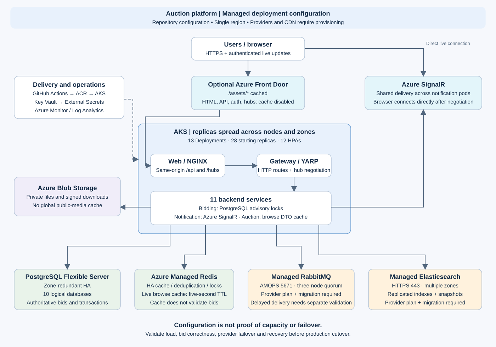

# Performance, HA and rollout

The repository now supports the configuration below. It has **not** been
provisioned or load-tested in Azure. Traffic targets are still unspecified;
replicas and autoscaler maxima are configuration, not proven capacity.



## What changed

| Area | Repository implementation | Remaining validation |
|---|---|---|
| Live updates | Notification optionally uses Azure SignalR; production enables it. Browser negotiates through `/hubs/notifications`, then connects directly to Azure SignalR. | Provision the service, supply its connection string and allowed origins; verify delivery across two notification pods and reconnects. |
| Browsing cache | Redis stores mapped DTOs for explicitly `Live` auction lists for five seconds. Seller/winner queries and authoritative reads bypass it. Bounded per-process locks coalesce cache fills. Cache errors fall back to PostgreSQL. | Measure hit rate and cache-outage DB load. This is bounded staleness, not immediate invalidation; clients should refetch auction details before bidding. |
| Write correctness | Auction writes now use the database repository directly. The old write-only cache decorator invalidated the wrong list keys and could make writes fail on cache outages. Bid locks and deduplication retain their existing behavior. | Run hot-auction, idempotency, wallet and close-time invariant checks. |
| Pod availability | Every production Deployment spreads replicas by zone and hostname. Analytics now has two replicas and HPA minimum two. Existing PDBs remain. | Kubernetes 1.27+ supports `matchLabelKeys`; check three-zone node capacity, pending pods and node-drain behavior. |
| Messaging/search | `production-managed` removes in-cluster RabbitMQ/Elasticsearch from the rendered manifest, configures AMQPS/HTTPS and durable quorum queues, and gives new search indexes one replica. | Provision suitable provider plans, migrate data, test failover, validate index replication and delayed-message behavior. |
| CDN | Optional Front Door template caches `/assets/*`; all other routes have caching disabled. NGINX marks hashed assets immutable, HTML revalidatable and API/hub responses `no-store`. | Verify cache hits, auth isolation, TLS, correct allowed origins and deployment version consistency. |

The obsolete entity cache decorator and its dedicated test have been removed.
The new cache stores DTOs, avoiding EF entity
serialization and tracked-entity reuse. Coalescing is per replica, not a
distributed lock. Cache operations have a 200 ms wait budget and callers wait
at most 100 ms for a cache fill before reading the database directly. Slow or
cold caches can therefore cause concurrent database reads; measure that load.

## Provider choices

- **Azure SignalR** fits the existing ASP.NET hubs without changing the client
  protocol. The template starts with Standard S1 and one unit: size it against
  actual connection/message rates. For zone-resilient requirements, select a
  supported Premium configuration/region and validate its availability model.
  [Microsoft scale-out guidance](https://learn.microsoft.com/en-us/aspnet/core/signalr/scale).
- **CloudAMQP** is an example RabbitMQ provider. Require three nodes in distinct
  failure domains, TLS on 5671, a provider-supported RabbitMQ version, and the
  delayed-message plugin used by this application. Verify region and plan
  availability rather than assuming every Azure/SEA plan is multi-zone.
  [CloudAMQP persistence](https://www.cloudamqp.com/docs/persistence/),
  [provider availability notes](https://www.cloudamqp.com/docs/faq/).
- **Elastic Cloud Hosted on Azure** supports Elasticsearch with multiple
  availability zones. Use a version compatible with the repository's 8.x client,
  at least two zones (prefer three for this workload), replicated indexes and
  snapshots. Size remaining nodes to serve peak load after a zone fails.
  [Elastic production planning](https://www.elastic.co/docs/deploy-manage/deploy/elastic-cloud/elastic-cloud-hosted-planning).

Azure Service Bus and Azure AI Search require application adapters; they are
not drop-in replacements for the current RabbitMQ/Elasticsearch integrations.
Third-party subscriptions are not created by `main.bicep`.

## Rollout sequence

1. Provision/update `main.bicep`, supplying `signalRAllowedOrigins` with the
   exact frontend HTTPS origin. Retrieve `signalRName` and put the service's
   **Default-mode** connection string in `AZURE_SIGNALR_CONNECTION` before
   running `bootstrap-key-vault.sh`. The ExternalSecret must reconcile before
   Notification starts. Local Docker development continues to use in-process
   SignalR and should use one notification replica.
2. Provision the managed RabbitMQ and Elasticsearch instances. Put their
   username/password pairs in the existing Key Vault secrets. The provider
   profile expects AMQPS 5671 and Elasticsearch HTTPS 443 with public trusted
   certificates. For private endpoints, adjust egress CIDRs to the actual
   private subnets; the shipped provider egress permits public endpoints only.
3. Rehearse migration in staging. Stop incoming writes, allow outboxes and
   consumers to drain, inventory ready/unacknowledged **and delayed** messages,
   error/skipped queues and scheduled work. Transfer/replay outstanding work
   with preserved IDs and reconcile totals. A fresh broker is not a data copy.
   Classic queues cannot be converted to quorum in place: use a fresh vhost or
   migrate into new queues, preserving bindings and application queue names.
4. Restore/reindex Elasticsearch, verify document counts, set existing indexes'
   `number_of_replicas` to at least one, and wait for green health. The new
   configuration only controls indexes created after deployment. Keep snapshots
   and a tested reindex path from PostgreSQL.
5. Only after reconciliation, scale the legacy RabbitMQ/Elasticsearch
   StatefulSets to zero. Do not delete their PVCs. CD blocks managed cutover
   while either old StatefulSet has desired replicas above zero. It does not
   prove a migration is complete or perform one automatically.
6. Set GitHub environment variables `KUBERNETES_OVERLAY=production-managed`,
   `RABBITMQ_HOST`, `RABBITMQ_VHOST`, and `ELASTICSEARCH_HOST`, plus the existing
   Azure variables. Render locally with the same environment:

   ```bash
   deploy/azure/render-kubernetes.sh > /tmp/auction-production.yaml
   ```

   Review the manifest and run the existing manual Azure CD deployment. The
   default `production` overlay still includes the original single-pod broker
   and search; it is not an end-to-end HA deployment.
7. Run [capacity and failure tests](../tests/load/README.md). Verify alerts for
   broker quorum, queue/outbox lag, DB connection/lock waits, cache errors,
   SignalR connections and dropped deliveries, unhealthy pods and payment/saga
   retries. The existing delayed-message plugin is not made fully replicated
   by quorum queues: test its loss/recovery separately and plan a durable
   scheduler if delayed delivery must survive permanent broker-node loss.

Rollback requires pausing writes and reconciling any events/index updates
created on the new providers. Do not simply point clients at an old broker
after the new broker has accepted messages.

## Optional CDN rollout

Deploy `deploy/azure/edge.bicep` **after** the web ingress has a DNS name and
valid certificate. `originHostName` must resolve directly to that ingress,
never back to Front Door. The template returns an `azurefd.net` frontend URL.
Add it to Azure SignalR's allowed origins. Set the optional GitHub/render
variable `FRONTEND_DOMAIN` to this public hostname; that controls CORS and
`FrontendUrl`, while `WEB_DOMAIN` remains the direct origin's ingress hostname.
Without a CDN, `FRONTEND_DOMAIN` defaults to `WEB_DOMAIN`.

```bash
az deployment group create --resource-group "$AZURE_RESOURCE_GROUP" \
  --template-file deploy/azure/edge.bicep \
  --parameters endpointName=<globally-unique-name> originHostName=origin.example.com
```

For a branded frontend domain, add its Front Door custom-domain binding,
managed certificate and DNS validation, and configure the corresponding
application origins. Those DNS changes are not automated here. WAF and origin
access restrictions are also separate rollout work; this template provides
CDN delivery, not a private or WAF-protected origin.

Check that `/assets/<hash>.js` returns immutable caching and subsequent edge
requests hit cache; `/`, `/api/*`, and `/hubs/*` must not return cached private
responses. Missing assets must return 404. Keep private Blob containers and
signed report/download URLs private. Public image CDN delivery requires a
separate public-media classification and route; it is not enabled globally.

## Limits that remain

This is a single-region design. PostgreSQL still hosts ten logical databases on
one server; HA does not increase write capacity. Budget total connection pools
across all replicas, including outbox and background workers, against server
limits. Do not introduce transaction-mode PgBouncer while bid serialization
uses session-level PostgreSQL advisory locks.

HPA uses CPU/memory rather than bid latency, active viewers or queue lag.
Gateway rate limits are per process. Region-level DR, recovery objectives,
restore drills, distributed rate limiting, public-media CDN delivery and a
durable replacement for delayed-message scheduling remain separate work.

## Local validation

- Full .NET solution build passed with zero warnings/errors; the final cache
  change also compiled and passed its application suite.
- Auction application: 24 tests passed. Shared infrastructure: 9 passed,
  13 database-dependent tests skipped without a configured test database.
- Frontend: typecheck and 15 SignalR/client-hook tests passed.
- Both production overlays rendered; checked 13 Deployments, 28 starting
  replicas, topology spread, public frontend origin and managed TLS settings.
- NGINX configuration validation and k6 script inspection passed. No load was
  sent to a deployed application.
- Both Bicep templates compiled. `main.bicep` retains existing schema/nullability
  warnings for ACR/Redis and resource-name bounds; run Azure `what-if` and
  provider validation before provisioning. No Azure deployment was performed.
